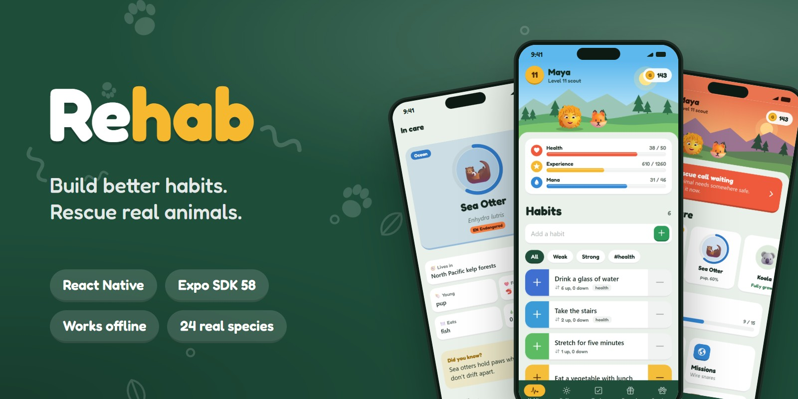
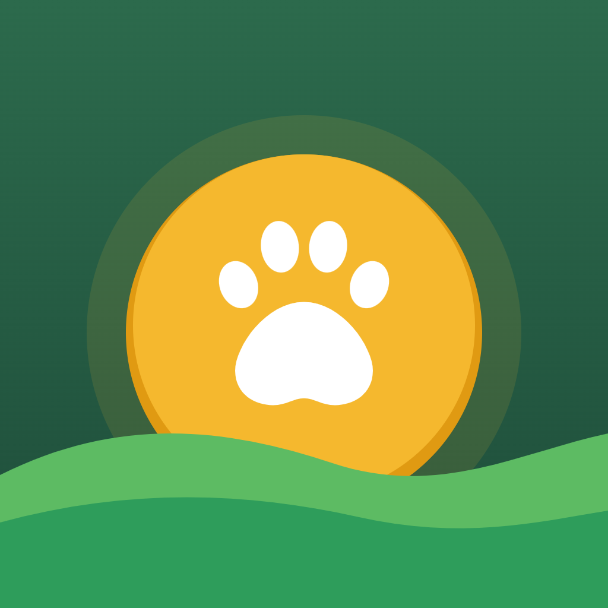
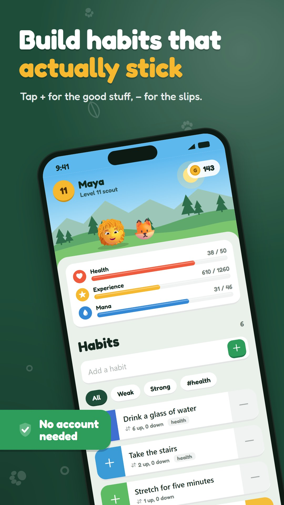
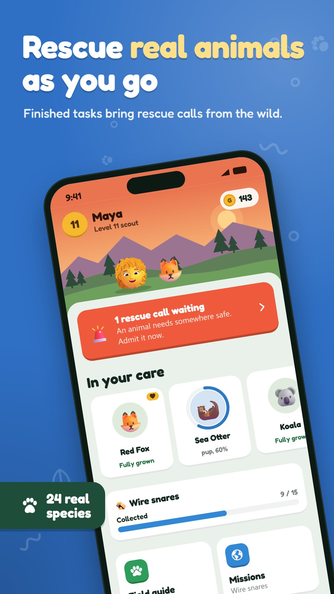
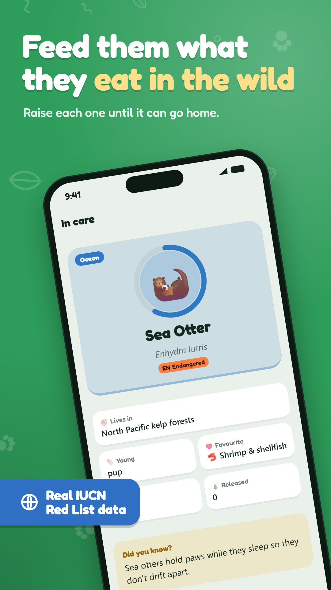
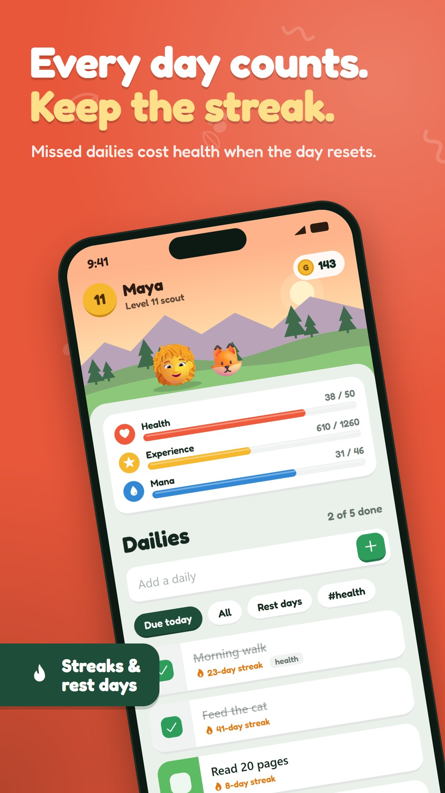
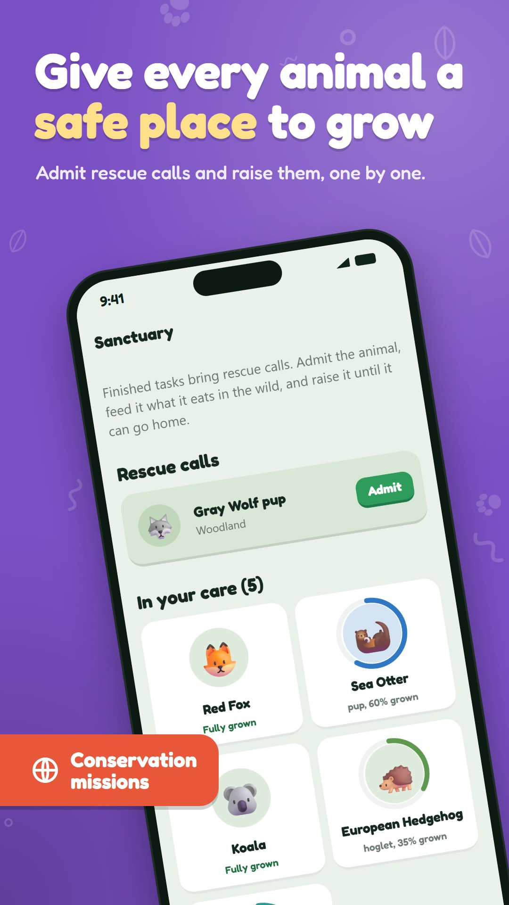
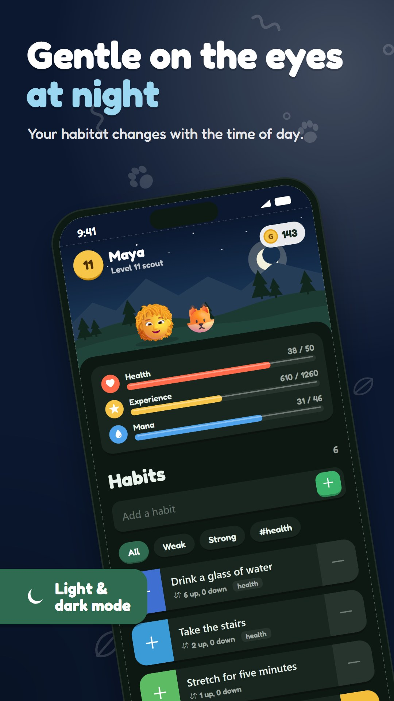

<p align="center">
  
</p>

<p align="center">
  <br />
  <b>A habit tracker that plays like a game, where finishing your tasks rescues real animals.</b><br />
  Free · Android 7.0+ · Works offline · No account, no ads, no tracking
</p>

<p align="center">
  <a href="https://github.com/mimobn/rehab-app/releases/latest"><b>⬇️ Download the latest APK</b></a>
</p>

---

## Install on Android

1. Open the [latest release](https://github.com/mimobn/rehab-app/releases/latest) on your phone and tap **`rehab-1.0.0.apk`** under **Assets**.
2. Open the downloaded file. If Android asks, allow your browser or file manager to **install unknown apps**.
3. Tap **Install**, then open **Rehab**.

To update later, download the newer APK and install it over the old one. Your progress stays.

## What's inside

<p align="center">
  
  
  
</p>
<p align="center">
  
  
  
</p>

- **Habits, dailies, to-dos and rewards.** Tap + for the good stuff and − for the slips, keep streaks alive, and buy treats with the gold you earn.
- **Tasks change colour** from ember red (neglected) to lake blue (strong), so you see at a glance what's slipping.
- **Rescue real animals.** 24 real species with their real habitat, real diet and IUCN Red List status. Feed them what they eat in the wild and raise them until they can go home.
- **Conservation missions** against oil spills, bushfires and wire snares rescue endangered animals you can't find anywhere else.
- **Game feel:** levels, health and burnout, four classes with skills, gear, badges and a habitat that follows the time of day.

## Privacy

Everything stays on your phone. Rehab has no account, no server, no analytics and no ads, and it only asks for vibration (plus the internet permission the framework includes). Read the full [privacy policy](PRIVACY.md).

## Verify your download

Each release lists the APK's SHA-256 checksum. Every Rehab release is signed with the same certificate:

```
SHA-256: ca9ccae3c50f006717291bb9d4588dae69e3b9e69b23c349f97edf5277bf4d1f
```

## Feedback

Found a bug or have an idea? [Open an issue](https://github.com/mimobn/rehab-app/issues).

---

<sub>This repository hosts Rehab's public releases. Rehab is a learning project inspired by gamified habit trackers such as Habitica; all of its code, rules and art are original.</sub>
